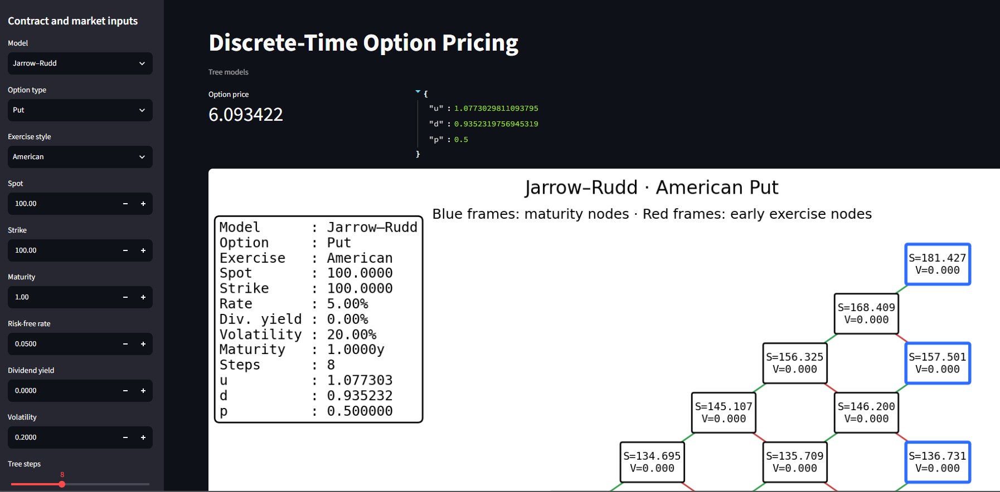
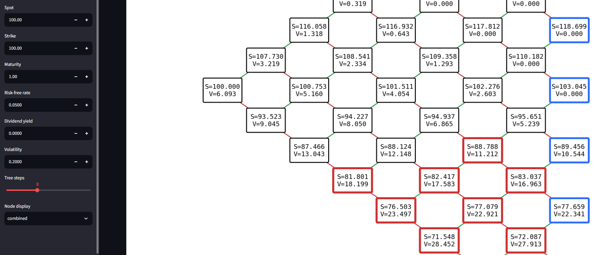

# Discrete-Time Option Pricing

A hybrid Python/C++ implementation of classical recombining tree models for option pricing.

The project emphasizes:

- clear separation between model calibration and backward induction;
- readable and inspectable Python implementations;
- high-performance C++ pricing through pybind11;
- numerical validation across independent implementations;
- interactive tree visualization.

## Implemented models

| Model | Python | C++ | European exercise | American exercise |
|:------|:------:|:---:|:-----------------:|:-----------------:|
| Cox–Ross–Rubinstein | ✓ | ✓ | ✓ | ✓ |
| Jarrow–Rudd | ✓ | ✓ | ✓ | ✓ |
| Tian 1993 | ✓ | ✓ | ✓ | ✓ |

The current implementation supports:

- call and put payoffs;
- European and American exercise;
- continuous dividend yield;
- memory-efficient backward induction;
- full-tree construction for inspection and visualization;
- convergence comparisons against Black–Scholes–Merton;
- Python/C++ numerical parity tests.

## Repository structure

- `src/payoffs.py`: payoff definitions
- `src/validation.py`: input validation
- `src/dates.py`: time-to-maturity utilities
- `src/pricers.py`: Python tree calibration and pricing logic
- `src/visuals.py`: tree-rendering utilities
- `cpp/include/`: C++ public interfaces
- `cpp/src/`: C++ pricing engine and pybind11 bindings
- `cpp/CMakeLists.txt`: CMake configuration for the C++ backend
- `tests/`: unit, convergence, and Python/C++ parity tests
- `benchmark/`: performance comparisons
- `examples/`: executable examples
- `notebooks/`: demonstrations and model comparisons
- `streamlit_app/`: interactive web application
- `figures/`: screenshots and sample output
- `references/`: research papers and supporting material

## Architecture

The Python and C++ implementations follow the same general decomposition:

1. calibrate the tree parameters \(u\), \(d\), and \(p\);
2. pass them to a common backward-induction engine;
3. evaluate continuation and intrinsic values at each node;
4. apply early exercise when the option is American.

Each binomial model is therefore responsible only for its own calibration:

- Cox–Ross–Rubinstein determines its specific \(u\), \(d\), and \(p\);
- Jarrow–Rudd determines its specific \(u\), \(d\), and \(p\);
- Tian 1993 determines its specific \(u\), \(d\), and \(p\).

The resulting parameters are then passed to a shared pricing engine.

The Python implementation prioritizes readability, inspection, testing, and visualization.

The C++ implementation follows the same pricing conventions while providing a substantially faster numerical backend through pybind11.

## Streamlit application

The Streamlit application provides an interactive interface for the CRR, Jarrow–Rudd, and Tian-1993 models.

It supports:

- model selection;
- option and market parameters;
- European and American exercise;
- call and put pricing;
- continuous dividend yield;
- graphical inspection of small binomial trees.

Run the application with:

```bash
python -m streamlit run streamlit_app/app_v1.py
```

### Application preview





## Numerical validation

The C++ implementations are tested directly against their Python counterparts for:

- CRR European calls;
- CRR American puts;
- Jarrow–Rudd European calls;
- Jarrow–Rudd American puts;
- Tian-1993 European calls;
- Tian-1993 American puts.

At 10,000 time steps, the observed absolute Python/C++ differences were:

| Model | Option | Absolute difference |
|:------|:-------|--------------------:|
| CRR | European call | `3.7428e-12` |
| CRR | American put | `1.5490e-12` |
| Jarrow–Rudd | European call | `6.2883e-13` |
| Jarrow–Rudd | American put | `2.6468e-13` |
| Tian 1993 | European call | `8.5443e-12` |
| Tian 1993 | American put | `3.3715e-12` |

The largest observed difference was approximately:

```text
8.55e-12
```

These residual differences are consistent with floating-point rounding and minor differences in operation ordering.

European-option prices are also compared with their Black–Scholes–Merton limits.

## Performance benchmark

Both implementations use backward induction with:

- time complexity: `O(N²)`
- memory complexity: `O(N)`

The following results were obtained on the same machine using identical model parameters:

| Steps | Python | C++ | Speed-up |
|------:|-------:|----:|---------:|
| 100 | 0.004819 s | 0.000136 s | 35.4× |
| 1,000 | 0.481343 s | 0.022063 s | 21.8× |
| 5,000 | 12.012378 s | 0.705207 s | 17.0× |
| 10,000 | 48.616593 s | 2.987780 s | 16.3× |

For the larger trees, the measured speed-up stabilizes around 16–17×.

Doubling the number of steps from 5,000 to 10,000 approximately quadruples the execution time in both implementations, consistently with the expected `O(N²)` complexity.

Small execution times are more sensitive to:

- interpreter and binding overhead;
- timer resolution;
- operating-system scheduling;
- background processes;
- compiler configuration.

Benchmark results may vary depending on hardware, compiler, optimization level, and build configuration.

## C++ backend

The C++ backend is built with:

- C++23;
- CMake;
- pybind11;
- MinGW-w64 on Windows.

The compiled extension exposes:

- `PayoffCall`
- `PayoffPut`
- `VanillaOption`
- `MarketData`
- `TreeConfig`
- `ExerciseStyle`
- `CRR_cpp_price`
- `JR_cpp_price`
- `TIAN93_cpp_price`

Example Python usage:

```python
import discrete_models

market = discrete_models.MarketData(
    spot=100.0,
    rate=0.05,
    dividend_yield=0.0,
    volatility=0.20,
)

config = discrete_models.TreeConfig(
    steps=10_000,
)

payoff = discrete_models.PayoffCall(
    strike=100.0,
)

option = discrete_models.VanillaOption(
    payoff,
    1.0,
    discrete_models.ExerciseStyle.European,
)

price = discrete_models.CRR_cpp_price(
    option,
    market,
    config,
)

print(price)
```

## Testing

Run the complete test suite with:

```bash
pytest
```

The tests cover:

- payoff behavior;
- input validation;
- European and American exercise;
- Python model convergence;
- comparison with Black–Scholes–Merton;
- Python/C++ numerical parity;
- CRR, Jarrow–Rudd, and Tian-1993 implementations.

## Planned extensions

- Leisen–Reimer binomial model
- Tian 1999 binomial model
- trinomial trees
- analytical and numerical Greeks
- richer convergence diagnostics
- convergence-rate comparisons between models
- discrete-dividend handling
- batch option pricing
- portable build configuration
- packaging of the C++ extension
- automated generation of Python type stubs

## References

### Primary papers

- John C. Cox, Stephen A. Ross, and Mark Rubinstein,  
  *Option Pricing: A Simplified Approach* (1979)

- Robert Jarrow and Andrew Rudd,  
  *Approximate Option Valuation for Arbitrary Stochastic Processes* (1982)

- Yisong Tian,  
  *A Modified Lattice Approach to Option Pricing* (1993)

- Dietmar Leisen and Matthias Reimer,  
  *Binomial Models for Option Valuation — Examining and Improving Convergence*

### Textbooks

- Tomas Björk,  
  *Arbitrage Theory in Continuous Time*

- Steven E. Shreve,  
  *Stochastic Calculus for Finance I*

- Mark S. Joshi,  
  *The Concepts and Practice of Mathematical Finance*

## Status

Active development.

The CRR, Jarrow–Rudd, and Tian-1993 models are operational in both Python and C++.

The project currently supports:

- European and American options;
- call and put payoffs;
- continuous dividend yield;
- full-tree visualization;
- Black–Scholes–Merton convergence testing;
- interactive Streamlit pricing;
- high-performance C++ pricing;
- cross-language numerical validation.